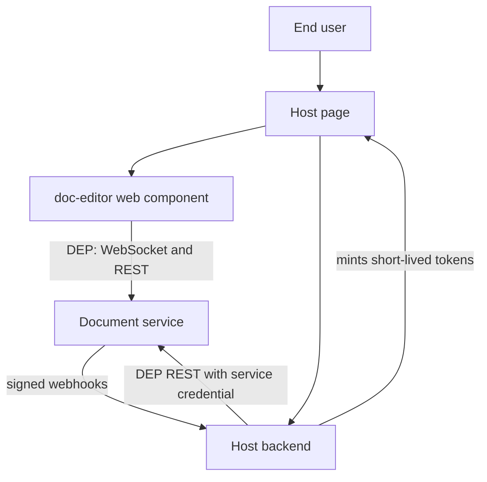
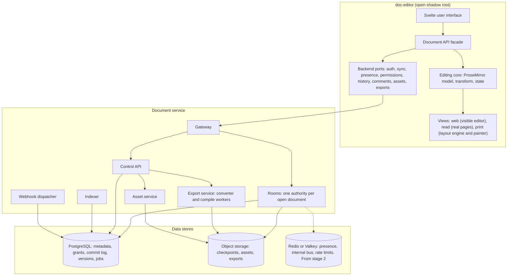
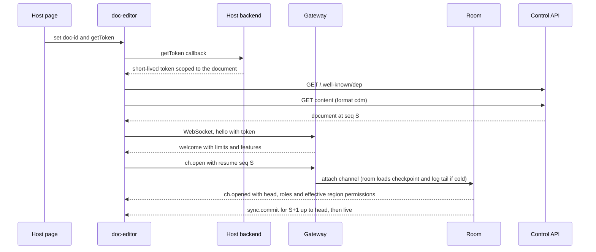
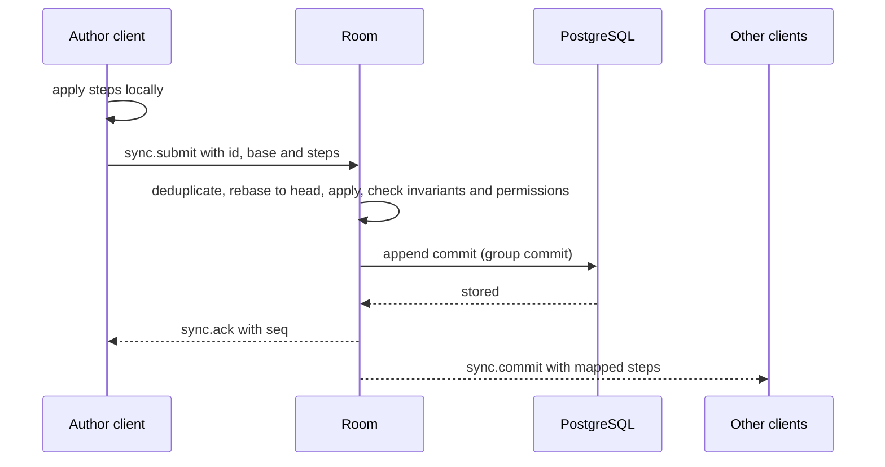
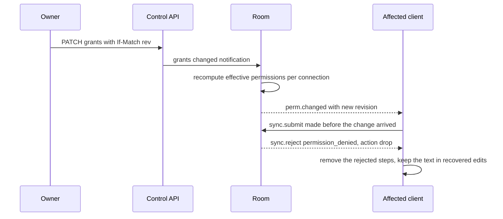
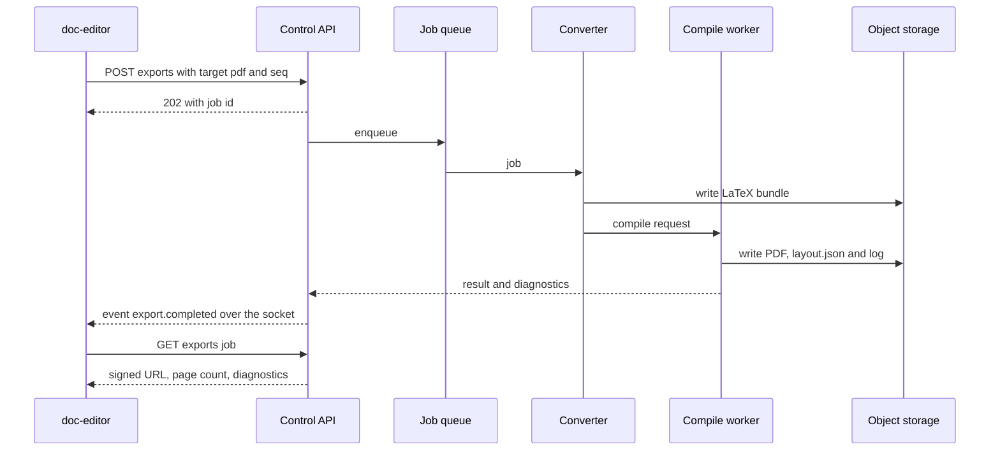

# 01 Architecture

**Status:** draft 0.2, 2026-09-18, revised after the first review ([review](../review/2026-09-18-pitfall-review.md)). Informative. Normative details live in documents 03 to 05, 07 and 12.

## 1. System context



The host backend owns users, sign-in and the document-level role of each user. The document service owns document content, region grants, history, comments, assets and exports. The two sides meet only at DEP.

## 2. Components



| Component | Responsibility | Specified in |
|---|---|---|
| Svelte user interface | Toolbar, style gallery, rulers, side panels for comments, history and permissions, dialogs, status bar | 02 |
| Document API facade | The only way the user interface and host code change a document. Hides ProseMirror so it can be replaced | 02 |
| Editing core | Document state, transactions, schema generated from the CDM, client half of the sync engine, region guard, suggestion mode | 02, 04 |
| Views | `web`: a visible ProseMirror view, continuous and reflowing, permanent. `read`: real pages, read-only, first from the typeset PDF. `print`: editable pages from a layout engine, DOM painter, caret and selection overlay and an input bridge, gated on evidence | 02 |
| Backend ports | Interfaces the component uses to reach any backend. Three implementations ship: DEP client, local (IndexedDB) and mock | 05 |
| Gateway | Terminates WebSockets, verifies tokens, applies rate limits, routes channels to rooms | 06 |
| Room | Hosts the authority for one open document: rebases, validates, checks permissions, assigns sequence numbers, persists, broadcasts | 04, 06, 07 |
| Control API | REST resources: documents, content, grants, history, comments, assets, exports, webhooks | 05, 06 |
| Export service | Converts a CDM document to a LaTeX bundle and compiles it in sandboxed workers | 09 |
| Asset service | Upload by pre-signed URL, validation, image processing, font manifest | 06, 10 |
| Indexer | Extracts text for search after checkpoints | 06 |
| Webhook dispatcher | Delivers signed events to the host backend with retries | 05, 06 |
| Rules package | One implementation of the field rules language, run by the editor, the authority and the authority service | 12 |
| Signing service | Seals final PDFs with a key held in a key service and adds time-stamps. Separate from the export workers | 12 |
| Reference host | A small host application that shows token minting, a document list, sharing, webhooks and "send for completion" | 13 |

## 3. Key decisions

| Decision | Summary | Record |
|---|---|---|
| Who orders edits | The server is the authority. Clients submit commits against a base version; the room rebases, validates, stores and only then acknowledges | [0001](../adr/0001-server-authoritative-sync.md) |
| Packaging | One hand-written custom element with an open shadow root; Svelte 5 mounted inside it | [0002](../adr/0002-single-custom-element-svelte-mount.md) |
| Editing core | ProseMirror model, transform and state behind the project's own document API | [0003](../adr/0003-prosemirror-core-behind-own-api.md) |
| Document model | Semantic model built from Word's concepts, serialised as versioned JSON; not a mirror of the DOCX package | [0004](../adr/0004-semantic-document-model.md) |
| Pagination | Own layout engine with a DOM painter as the end state; a visible editor with page guides first | [0005](../adr/0005-own-layout-engine-dom-painter.md) |
| Storage | PostgreSQL for relational data and the commit log; object storage for checkpoints, assets and exports | [0006](../adr/0006-postgres-plus-object-storage.md) |
| Export | Canonical JSON to a project-owned LaTeX writer to sandboxed LuaLaTeX workers | [0007](../adr/0007-latex-export-pipeline.md) |
| Protocol shape | One multiplexed WebSocket for sync, presence and notifications; stateless REST for everything else; signed webhooks | [0008](../adr/0008-protocol-planes-and-encoding.md) |
| Permission unit | Regions are block containers with stable identifiers; grants live outside the document | [0009](../adr/0009-regions-as-block-containers.md) |
| History | The commit log is the history; versions are pointers; restore moves forward | [0010](../adr/0010-history-from-commit-log.md) |
| Fields | Field values live in the document tree; a `fill` capability lets a person change only the values of their own fields | [0011](../adr/0011-fields-in-tree-and-fill-capability.md) |
| Rules | A closed, typed JSON rule language with one shared implementation | [0012](../adr/0012-typed-json-rules.md) |
| Signing | A simple electronic signature with evidence and a sealed PDF natively; advanced and qualified signatures through providers | [0013](../adr/0013-signing-stance.md) |
| Features | Word for the web as the feature benchmark, with the product's own design; ports for proofing and assistants; a host-registered extension tier first | [0014](../adr/0014-experience-benchmark-and-extensions.md) |
| Comments | Comment ranges are kept and mapped by the document service, not stored in the document | [0015](../adr/0015-comments-as-mapped-ranges.md) |
| Compute kernels | TypeScript everywhere; Rust compiled to WebAssembly only for measured compute kernels behind interfaces the spec already has | [0016](../adr/0016-rust-wasm-compute-kernels.md) |
| Word round trip | Lossless DOCX round trip through a preservation layer: the original package and a source map outside the document, preserved properties and preserved atoms inside it | [0017](../adr/0017-lossless-docx-preservation-layer.md) |
| Attribute grammars | Every CDM attribute has a grammar and a default; the canonical-form rules are completed and versioned | [0018](../adr/0018-cdm-attribute-grammars.md) |
| Read restrictions | Regions and field values hidden from some readers through per-reader projections of the one log | [0019](../adr/0019-read-restrictions-by-projection.md) |

## 4. Core flows

### 4.1 Open a document



### 4.2 Edit



A commit is acknowledged and broadcast only after it is stored. The primary key on document and sequence number fences out a second writer.

### 4.3 Grant change while people are editing



### 4.4 Export



### 4.5 Restore

The client asks the control API to restore a document or one region to an earlier sequence number. For one region, the room computes block-aligned steps from the current head to the target content and applies them as a commit with origin `restore`. For a whole document it records a snapshot commit and clients reload. Either way a `pre-restore` version is recorded first, the room re-checks permissions and approvals when it applies the change, and history is never rewritten. See 08.

### 4.6 Fill and sign

A workflow freezes the body and activates participants in order. A participant's fills are ordinary commits that the authority accepts only for the values of fields assigned to their role. Signatures are written by the server during the signing ceremony. Completion triggers an export at that sequence number, and a separate signing service seals the PDF. See 12.

## 5. Deployment modes

| Mode | Who runs the document service | Storage |
|---|---|---|
| Hosted | The vendor, multi-tenant | Vendor's PostgreSQL and object storage |
| Self-hosted | The customer, from published container images | Customer's PostgreSQL and S3-compatible storage through storage adapters |
| Bring your own backend | The customer implements DEP themselves, in one of the three tiers of 05, section 9, usually with the authority service for document semantics | Anything; proven by the conformance kit |
| Local | Nobody. The component uses its local backend | IndexedDB in the browser |

## 6. Repository and package layout

A TypeScript monorepo with pnpm workspaces.

```
packages/
  model/            CDM types, schema, validation, migrations, ProseMirror schema
  authority/        Pure functions: rebase, apply, invariants, permission outcome check, range mapping
  rules/            The field rules language: parser, type checker, evaluator, fixtures
  engine/           Editing core: state, commands, sync client, region guard, suggestions
  layout/           DOM-free layout engine (read and print views)
  layout-kernel/    The layout kernel as an npm package: typed loader and the WebAssembly build of crates/layout-kernel (ADR 0016)
  painter/          DOM painter; caret and selection overlay and input bridge for the print view
  ui/               Svelte 5 components
  element/          The custom element and the distributable bundle
  protocol/         DEP types, codecs, client state machines
  backend-dep/      Backend ports over DEP
  backend-local/    Backend ports over IndexedDB and BroadcastChannel
  backend-mock/     In-memory backend for tests and demos
  export-latex/     CDM to LaTeX converter, house class, typed emitters, source map
  export-docx/      CDM to DOCX writer (a package patcher for imported files, ADR 0017) and DOCX importer (phase 2)
  tck/              Conformance kit: black-box tests, fixtures, fuzzers
crates/             Rust workspace of the WebAssembly kernels (ADR 0016), pinned toolchain and builder image; built by packages/layout-kernel
services/
  document-service/ Gateway, rooms, control API (reference implementation, Node.js)
  authority-service/ The authority package behind a network interface for non-JavaScript backends (05, section 10)
  export-worker/    Sandboxed LuaLaTeX compile worker and its container image
  asset-worker/     Image validation and processing
  signing-service/  Seals final PDFs; keys stay in a key service
apps/
  reference-host/   Sample host application and compose file
docs/               This specification
spec/               Machine-readable DEP and CDM artifacts (Phase 0)
```

The Rust crates are the only code outside the pnpm workspace. They sit in `crates/` with their own `Cargo.toml`, `Cargo.lock` and `rust-toolchain.toml`, and only `packages/layout-kernel` builds them (`pnpm --filter @docedit/layout-kernel build:wasm`, in a Podman image that holds the pinned toolchain). The project's own crates forbid unsafe code (ADR 0016, decision 5).

`authority` has no dependency on Node.js or the browser so that the same code runs in the room, in the authority service, in the local backend and in tests.

## 7. Technology choices

| Area | Choice | Notes |
|---|---|---|
| Language | TypeScript, strict mode | One language across the component and the reference service lets them share the model and the authority |
| Component UI | Svelte 5 | Mounted into the shadow root; see 02 |
| Editing core | prosemirror-model, prosemirror-transform, prosemirror-state, prosemirror-history | MIT licensed. prosemirror-view is the web view; its role in the print view is decided by spike S9 |
| Service runtime | Node.js 22 or later | Stage 1 is one room-host process with worker threads for heavy work. Several processes, sharded by document, arrive with stage 2 and its internal bus |
| Relational store | PostgreSQL 16 or later | Row-level security per tenant |
| Object store | Any S3-compatible store, or Azure Blob through an adapter | |
| Cache and coordination | Redis or Valkey, from stage 2 | Presence, the internal bus between nodes, rate limits. Room ownership is in PostgreSQL, not here |
| Job queue | PostgreSQL-backed queue in stage 1; a managed queue later | Keeps stage 1 to two stateful dependencies |
| Typesetting | LuaLaTeX from a pinned TeX Live 2026 image | See 09 |
| PDF preview | PDF.js inside the component | |
| Math | Stored as LaTeX; KaTeX for display; MathLive for editing | |

## 8. Cross-cutting conventions

| Topic | Convention |
|---|---|
| Identifiers | UUID version 7 in canonical text form for documents, commits, sessions, assets, jobs and threads. Node identifiers inside a document are 16-character URL-safe random strings |
| Time | RFC 3339 timestamps in UTC with millisecond precision. The server clock is the only trusted clock |
| Lengths | Integers in twentieths of a point (1/1440 inch), including font sizes. One point is 1/72 inch: the CSS `pt` and TeX's `bp`, so the LaTeX writer divides by 20 and emits `bp` |
| Numbers | The CDM contains no floating-point numbers. Decimal values are strings |
| Colours | `#RRGGBB` strings |
| Canonical JSON | RFC 8785 plus the CDM's canonical form rules (03, section 2) wherever a hash of a document is taken |
| Hashing | SHA-256 |
| Compression | Zstandard for stored checkpoints and commit payloads; HTTP content encoding is negotiated normally |
| Language tags | BCP 47 |
| Errors | RFC 9457 problem details over REST; typed error messages over the socket; both carry a stable `code` |

## 9. Open issues

- Whether the gateway and the rooms are separate deployables from the start or split at stage 3 (the spec assumes they start as one process).
- Whether the reference service should also be published as an embeddable library for Node.js hosts.
- The cloud target for the hosted mode. Nothing in the design depends on one provider.
