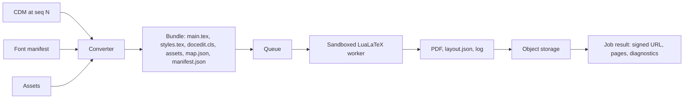

# 09 Export and LaTeX

**Status:** draft 0.2, 2026-09-18, revised after the first review ([review](../review/2026-09-18-pitfall-review.md)). Informative, except sections 4 (emitters), 6.3 (math gate) and 9.3 (sandbox rules), which are requirements.

Final output is typeset by LaTeX. The CDM document is the source of truth and LaTeX is generated from it; nobody edits the generated LaTeX (assumption A4). The decision is recorded in [ADR 0007](../adr/0007-latex-export-pipeline.md).

## 1. Pipeline



The converter is a stateless TypeScript package (`export-latex`) that shares the CDM types, the numbering algorithm and the layout semantics (03, section 7) with the editor. It does not go through Pandoc: Pandoc's document model has no page geometry, headers and footers, tab stops, fonts, colours or tracked changes, so routing through it would discard exactly what a Word-like document carries. Pandoc remains useful later for Markdown and EPUB output.

A preflight shared by the editor and the converter warns before export about things that will not typeset well: a table row taller than a page, a table inside a multi-column section, characters no loaded font covers, images without alternative text.

## 2. Bundle

| File | Contents |
|---|---|
| `main.tex` | Document body. Machine-generated, one block per group of lines, no user-authored TeX outside math |
| `styles.tex` | Macros generated from `style_def` and `numbering_def` nodes, with inheritance already flattened. Macro names are generated; they are never derived from identifiers or names that a user chose |
| `docedit.cls` | The house class: package loading, page machinery, the macros `main.tex` uses, the Lua code that reports layout. Versioned; the version is part of every cache key. Its licence, and the licences of everything the image ships, are recorded in a manifest generated from the TeX Catalogue |
| `assets/` | Images named by content hash. SVG is converted to PDF when the asset is processed, not at compile time |
| `map.json` | Line ranges of `main.tex` mapped to block identifiers, for diagnostics |
| `manifest.json` | `seq`, the hash-chain head, CDM version, class version, fonts with hashes, options, and the hash of the whole bundle |

Fonts are not in the bundle. Workers have the font files of the manifest on a read-only path, identified by hash.

## 3. Mapping

### 3.1 The class is built for tagged PDF from the start

Accessible, tagged PDF (section 13) is a constraint on the house class from phase 1, not a switch for later. Several popular packages do not work with the LaTeX project's tagging support as of 2026-09, among them `titlesec`, `multirow`, `enumitem`, `tabto`, `caption` and `float`; switching them out late would move every page break and invalidate every reference PDF. The class therefore avoids them: heading formatting is built on the kernel's sectioning commands, lists and their labels are the class's own, tab stops are implemented in Lua, and row spans do not use `multirow`. The PDF is validated with veraPDF in continuous integration from spike S4 onwards. Preview compiles may use draft tagging to save time.

| CDM | LaTeX |
|---|---|
| Page setup, page sections | `geometry` for the first page setup. `\newgeometry` ignores paper size and forces a page break, so size and orientation changes set the page dimensions and the header width directly, per page setup. A `continuous` break that changes margins cannot be honoured and is reported |
| Headers and footers | `fancyhdr` page styles generated per page setup, with first-page and even-page variants. The class measures the header box and enlarges the top margin when the header is taller, to match the layout semantics of 03 |
| Fields | `page` to `\thepage`; `pageCount` to the last-page reference; `ref` to a page reference or to literal label text; `seq`, numbering and cross-references to numbered items print literal labels computed by the shared algorithm; `date` prints the server's date at job creation in the job's time zone, never a value supplied by a client |
| Paragraph styles | One generated macro per style that sets font, size, leading, alignment, indents, spacing, keep-with-next and widow and orphan penalties |
| Headings | Kernel sectioning commands with class-defined formatting, so PDF bookmarks and the table of contents work natively. Text in moving arguments (titles, captions, table-of-contents entries, bookmarks) is emitted in a plain form as well |
| Spacing | Paragraph gaps follow the larger-of rule of 03, section 7. Line spacing under `multiple` is applied per line in a `post_linebreak_filter` callback, because a paragraph-wide `\baselineskip` is not what Word's rule means |
| Numbering | Literal labels from the shared algorithm, set by the class's own list macros. LaTeX counters are not used for list numbers, so skipped levels, tables between items and deep nesting cannot break them |
| Tables | Section 3.2 |
| Images and figures | `graphicx` with explicit width and height; figures are placed where they occur unless `placement` is `float` |
| Footnotes | `\footnote`, and `\footnotemark` with `\footnotetext` in places where a footnote cannot be set directly |
| Links and bookmarks | `hyperref`, through the URL emitter of section 4 |
| Highlight, underline, strike | `lua-ul`; colours with `xcolor` |
| Languages | `babel`, loaded only through its ini-based interface with shorthands and automatic punctuation spacing switched off, so that no language module rewrites the user's text |
| Breaks | Line, page and column breaks map directly |
| Regions | Not visible in output |
| Form fields | Values flattened into the text at a fixed width, tagged with their labels; the rectangle of every field is reported in `layout.json` (12, section 12) |

### 3.2 Tables

`longtable` never breaks a page inside a row, does not work inside multi-column sections, and cannot be used in headers, footnotes or cells. One writer is therefore not enough:

| Where | Writer | Limits |
|---|---|---|
| Body flow, single column | `longtable` with `colortbl`; column widths from `grid`; header rows repeat | A row taller than a page is split by the converter at paragraph boundaries into continuation rows, with a warning |
| Inside multi-column sections, headers, footers and footnotes | A boxed `tabular` | Cannot span pages; reported by the preflight |
| Row spans | The class's own cell macros | Spanned content that is taller than its rows is reported |

Constructs that map badly and how they are handled:

- **Tab stops** are implemented by the class. Right-aligned and decimal tabs inside justified text are approximate.
- **Automatic table widths** do not exist in LaTeX. The editor always computes and stores a `grid`, and the converter uses it.
- **Text ligature conventions.** TeX turns `--`, `---`, quotes typed as backticks and similar sequences into other characters. The class switches TeX ligatures off (`Ligatures=TeXOff`) on every font it loads, including fallback fonts, so that text appears as typed.
- **Spaces.** TeX collapses runs of spaces; Word does not. The converter emits explicit spaces for every space after the first, and for leading and trailing spaces.
- **Missing glyphs.** TeX only writes a log line when a font lacks a character, and a character would silently vanish from a signed PDF. The converter checks every character against the fonts' character maps and the fallback chain, and the class sets `\tracinglostchars=3` so that a miss is an error. For final exports a missing glyph fails the job.

Every job returns a list of warnings for constructs that were approximated.

## 4. Typed emitters

User-controlled strings reach TeX in many contexts, not only as body text: key-value options (alternative text, PDF metadata), URLs, numbering templates and bullet characters, labels, colours, lengths and language names. Escaping for body text is wrong in most of them.

The converter MUST write output only through these emitters, and nothing else may concatenate a user-controlled value into TeX:

| Emitter | Use | Rule |
|---|---|---|
| `text` | Body text | Escapes `\ { } $ & # _ % ^ ~`; maps the no-break space and soft hyphen; removes control and bidirectional override characters; NFC; guards a `[` that follows a line break or an item |
| `pdfString` | Bookmarks, metadata, alternative text, link titles | PDF string encoding; no TeX commands survive |
| `kvValue` | Any key-value option | Braced, with `,`, `=`, `]` and braces neutralised |
| `url` | Link targets | Scheme allow-list of invariant I9 (so no `run:` or `file:` actions); percent-encoding of every character outside RFC 3986, and the whole target reaches TeX hex-encoded, so no character of it is read as TeX (owner decision 25, [owner-decisions-2026-11-15](../owner-decisions-2026-11-15.md)) |
| `dimen` | Every length | Converted from the CDM's integers and clamped to a safe range |
| `color` | Colours | Six hexadecimal digits |
| `enumLookup` | Languages, alignment, formats, bullet characters | The value selects an entry from a fixed table; the value itself is never written |
| `generatedId` | Labels, macro names, file names | Derived from a counter or a hash, never from user input |

Invariant I11 of the CDM is the other half: every attribute has a grammar, checked when it is set, so hostile values are rejected long before export.

The emitters have fuzz tests per context and per language. The oracle for `text` is "the compiled PDF's extracted text equals the input"; for the others, "the job compiles, and a trace of the token stream contains no control sequence the emitter did not write".

## 5. Fonts

The worker loads the same font files as the editor through `fontspec`, by file path and hash, never by system lookup. A tenant's uploaded fonts are available only to that tenant's jobs. The font licence must permit server-side use; the manifest records it.

## 6. Math

### 6.1 Storage and editing

Equations are stored as LaTeX in the `latex` attribute. The editor renders them with KaTeX and edits them with MathLive. For DOCX, the server converts between LaTeX and Office math through MathML. The converter for that is chosen in a spike: Microsoft's stylesheet is not redistributable and the strongest open-source converter is under the GPL, which is acceptable only as a separate process. Equations that cannot be converted are exported as images with the LaTeX source as alternative text. Imported Office math becomes editable LaTeX only if the conversion passes the gate below. Since the owner's decision on A2 (2026-11-06), an imported equation must also be written back as its original Office math while it is not edited, and one that fails the gate or cannot be converted is kept as preserved content with an image fallback (03, section 4.6) instead of becoming an image. How inline atoms keep their original XML is open in ADR 0017.

### 6.2 Why math is the dangerous part

Math is the only place where TeX written by a user reaches the engine. It therefore has its own gate.

### 6.3 Math gate

The document service MUST validate every `latex` attribute when the commit that sets it is processed (invariant I8) and again in the converter:

- Parse it with KaTeX in strict mode with `trust` off and a macro expansion limit. What KaTeX rejects is rejected.
- Every control sequence MUST be on an allow-list: the intersection of what KaTeX supports and what `amsmath` and the chosen math font provide, minus the commands below.
- Reject definitions and low-level primitives regardless of spelling, including `\def`, `\let`, `\csname`, `\catcode`, `\input`, `\include`, `\openin`, `\write`, `\directlua`, `\special`, `\immediate`, `\newcommand`, and the `^^` character notation.
- Reject commands that paint outside their own box or hide other content: `\rlap`, `\llap`, `\smash`, `\raisebox`, `\colorbox`, `\fcolorbox`, `\rule` and `\kern`, `\hskip`, `\hspace` with negative or large arguments. Every dimension argument is bounded. Without this, a person who may edit only one region could cover a price in another region with a white box in the PDF that gets signed.
- Reject unescaped `%`, `#`, `~` and a stray `&` outside alignment environments. `\text{50% of}` balances its braces but comments out the closing one.
- Allow only one display environment, `equation` (numbered or not), and let the class supply it: the converter writes the wrapper around the value, so a value holds `aligned`, `gathered`, `cases` or a matrix environment and is rejected if it names `equation` itself, `align`, `gather`, `multline` or `eqnarray`. This way the editor and the typesetter count equation numbers the same way (owner decision 211, 2026-11-17).
- Limit length to 4,000 characters and nesting depth to 50. The class clips every equation to its box.

An equation that fails is rejected at edit time. If one reaches the converter anyway, it is replaced with a visible placeholder and a diagnostic.

## 7. Pagination parity

TeX decides the final line and page breaks. What the editor shows can only approximate that, unless the design closes the gap.

| Level | What the user sees | Cost |
|---|---|---|
| L0 | The web view shows no pages. A PDF preview and the read view show the truth | None beyond the preview |
| L1 (opt-in, from phase 3) | After each compile, the page view adopts the typesetter's line and page breaks for paragraphs that have not been edited since. Pages match the PDF until the next edit upstream | The compile must report layout (7.1) |
| L2 (experimental) | Lines match even for edited text, because the class forces the same first-fit breaks the editor computes, with the same fonts, no hyphenation and fixed leading | Gives up TeX's paragraph quality. If it is ever built, breaks are forced with penalties before TeX's own line breaker runs; the line breaker is not replaced, because a replacement would have to reimplement how inserts, marks and vertical material migrate |

Rebuilding TeX's paragraph and page builders in the browser is not attempted.

### 7.1 `layout.json`

```json
{
  "seq": 416,
  "classVersion": "1.3.0",
  "granularity": "line",
  "pages": [
    { "n": 1, "setup": "ps1", "starts": { "blockId": "p3Jq8sLw0aZx1VbN", "offset": 0 }, "opensWith": "text" },
    { "n": 2, "setup": "ps1", "starts": { "blockId": "pA1b2C3d4E5f6G7h", "offset": 412 }, "opensWith": "tableHead" }
  ],
  "blocks": { "pA1b2C3d4E5f6G7h": { "lineStarts": [0, 96, 188, 301, 412, 498] } },
  "fields": { "fQ2x8Lm0aZx1VbN7": { "page": 2, "rect": [1440, 9020, 3360, 9300] } }
}
```

- The class marks every block's material with a LuaTeX attribute that identifies the block, and marks text runs with their starting offset. Lua code in the kernel's shipout hook reads each page. It reports how a page opens (`text`, `float`, `tableHead`, `footnoteContinuation`), because the first material on a page is not always body text.
- `offset` counts UTF-16 code units of the block's text, with each inline atom counting as one; bookmarks count as zero.
- Line starts per block, table rows per page and column breaks are reported when `granularity` is `line`. Block-level page starts are the guaranteed minimum. Spike S4 establishes how precise offsets can be.
- The file is validated against a schema before anything uses it (section 9.3).

What the editor does when its own layout disagrees with a reported break is defined in 02, section 9.7.

## 8. Engine and performance

- **LuaLaTeX.** It loads OpenType fonts by file, shapes complex scripts with HarfBuzz, exposes the callbacks needed for section 7, and is the preferred engine of the LaTeX project's tagged PDF work. Tectonic is not suitable because it is XeTeX-based and has no Lua.
- Published timings for TeX Live 2025 are about 1.4 seconds for a one-page document and about 23 seconds for 10,000 plain paragraphs. Those are lower bounds: they exclude this class's fonts, `hyperref`, `babel`, tables, tagging (reported as roughly three times slower) and second and third passes. Spike S4 measures the real class with tagging on.
- Speed-ups: a pre-built font name cache in the image; engines that are started ahead of time inside fresh sandboxes and wait past the preamble; a preview profile with draft tagging and one pass; PDFs cached by bundle hash, with previews and final exports cached separately.
- **No `.aux` reuse between jobs.** An `.aux` file is executed as TeX, so reusing one would let a single sandbox escape persist into later jobs and other users' exports, and it would make output depend on history. Final exports run from a clean state until page references stop changing, and the result records that it converged. A one-pass preview may show stale page numbers in the table of contents and says so.
- Capacity planning starts from one core and up to 1.5 GiB of memory per running job.

## 9. Compile service

### 9.1 Job flow and options

`POST /documents/{id}/exports` creates a job (05, section 6). States: `queued`, `converting`, `compiling`, `completed`, `failed`, `cancelled`. Progress is pushed as `export.progress` events. The result holds a signed URL with an expiry (on the asset origin of 10, section 3.5, with a fixed content type, `nosniff` and a download disposition for each file; never a URL of the object store; owner decision 66), the page count, the URL of `layout.json`, whether page references converged, warnings and diagnostics. A second request for the same bundle and profile returns the first result.

| Option | Values |
|---|---|
| `profile` | `preview` or `final` |
| `suggestions` | `accept`, `reject`, `markup` (section 10) |
| `comments` | `none`, `margin` |
| `fields` | `flatten` (default), `blank` |
| `tagging` | `on`, `draft`, `off` |
| `pdfStandard` | For example `ua-2`, `a-4` |
| `locale`, `timeZone` | For dates and language-dependent text. Defaults: `locale` is the document's language (`settings.lang`), else `en-GB`; `timeZone` is `UTC` (owner decision 148). The job records the values it used in `manifest.json` |
| `certificate` | Append the certificate of completion (12) |

Interactive previews and user-requested exports use separate queues so a bulk export cannot starve previews. Each tenant has a concurrency limit and a monthly budget of compile minutes. Preview compiles run only while someone is looking at a view that needs them (06, section 10).

### 9.2 Diagnostics

The worker runs with file and line error messages enabled. The service parses the log with a bounded parser, treats it as hostile input (user text can imitate log lines), maps lines to blocks through `map.json`, and returns entries of the form `{ severity, code, blockId, message }`. Raw logs are available to document editors only.

### 9.3 Sandbox rules

1. Workers compile only bundles produced by the converter. There is no feature for raw LaTeX blocks, custom preambles or uploaded packages.
2. Shell escape is disabled. `openin_any` and `openout_any` are set to paranoid. LuaTeX is version 1.17 or later: earlier versions allowed shell execution with shell escape off (CVE-2023-32700) and had sockets enabled by default (CVE-2023-32668). LuaTeX's `--safer` flag is not used, because it disables OpenType font loading. Lua's `debug` and file libraries remain reachable inside LuaTeX, so any TeX injection must be assumed to mean arbitrary Lua: the container is the boundary.
3. Each job runs in its own single-use sandbox (gVisor or a Firecracker microVM) with no network, a read-only root file system, a temporary working directory, all capabilities dropped, and a non-root user. Nothing a job wrote is visible to another job.
4. Limits per job: 120 seconds of wall clock, one core, 1.5 GiB of memory, 2,000 pages, 200 MiB of output, 256 MiB of working directory.
5. The class loads a fixed list of packages. The image is a curated TeX Live 2026 installation, pinned by digest. Distributing the image carries licence obligations (LuaTeX is under the GPL, most packages under the LPPL); the release includes the licence manifest and a source offer.
6. Workers hold no credentials other than a write-only, per-job upload location. Signing keys are never on a worker (12).
7. **Worker outputs are hostile.** The PDF viewer runs in a sandboxed cross-origin frame with script evaluation disabled, because a PDF parser bug would otherwise run in the host page's origin. `layout.json` is validated against its schema. Logs go through the bounded parser. The downloadable `tex` bundle carries a notice that it should be compiled with the same restrictions.
8. Before a final PDF is sealed, the bundle is compiled on two independent workers and the results are compared.

### 9.4 Reproducibility

The same bundle and the same image produce the same PDF: `SOURCE_DATE_EPOCH` and `FORCE_SOURCE_DATE` are set from the job, the job path is fixed, fonts are addressed by hash, and the image is pinned. A TeX Live upgrade is a class version change, tested against stored reference PDFs before it is rolled out, because it can move line and page breaks.

### 9.5 Scaling

Stateless workers pull from the queue and scale on queue depth with a warm minimum, since a cold worker has to load a large image. Containers on any orchestrator work; functions-as-a-service platforms are a poor fit because of image size and start-up time.

## 10. Suggestions and comments in output

The `suggestions` option chooses `accept` (as if all were accepted), `reject` (as if none were) or `markup` (insertions and deletions rendered in colour, comments in the margin). When a document has unresolved suggestions and the option is missing, the request fails with `pending_suggestions`, so nobody ships unreviewed text by accident. A suggested deletion of a whole block is honoured only if the suggestion passes the permission rules; the exporter never drops a region because of a mark it cannot verify.

## 11. Other targets

| Target | How |
|---|---|
| `tex` | The bundle as an archive, including the class, so it compiles outside the service |
| `docx` | An OOXML writer from the CDM in `export-docx`. Suggestions become `w:ins` and `w:del` with author and date; comments become Word comments; regions follow 07, section 15; fields follow 12, section 12. For a document imported from Word, the writer patches the original package, as [ADR 0017](../adr/0017-lossless-docx-preservation-layer.md) describes. It copies unedited parts and elements verbatim, writes preserved properties back onto edited elements, and re-inserts preserved fragments, so that the file round-trips without loss |
| `cdm` | The canonical JSON |
| `html`, `md` | Direct writers, in phase 2, because pasting into and out of other tools is part of everyday use |
| EPUB | Later, through a Pandoc JSON writer |

## 12. DOCX import

Import is a job, scheduled in phase 2 because most real use starts with "upload my existing Word file". The importer reads the package in a sandboxed worker with limits on entry count, total size and compression ratio; rejects any XML with a document type declaration; never follows external relationships; refuses macro-enabled files; and treats embedded objects as opaque: it never parses or runs them. It builds on an existing parser under a permissive licence where one fits. It maps Word structures to the CDM, substitutes fonts through the manifest, and turns the authors of tracked changes into labels.

Since the owner reversed assumption A2 on 2026-11-06, Word files must round-trip without loss, through the preservation layer of [ADR 0017](../adr/0017-lossless-docx-preservation-layer.md).

- The original file is kept as an immutable asset, and the import writes a source map next to it.
- Properties the model does not represent are kept as preserved properties.
- Content it cannot represent (text boxes, shapes, charts, SmartArt, embedded objects, nested tables, floating objects) becomes preserved atoms with fallbacks, instead of being dropped.
- The import still returns warnings for what it approximated, and for what it preserved but people cannot edit.

## 13. Accessible PDF

With the LaTeX project's tagging support in TeX Live 2026, the class produces tagged PDF (PDF/UA-2 and PDF/A-4 declarations, document language, table header rows, alternative text on graphics). Section 3.1 explains why this shapes the class from the beginning. Accessible output requires alternative text on every image; the job reports missing ones. Form support in `hyperref` is not compatible with tagging, which is one reason field values are flattened.

## 14. Testing

- A corpus of CDM documents with reference PDFs, compared by extracted text positions and by rendered pixels, and validated with veraPDF.
- The emitter fuzz tests of section 4 and a fuzz test of the math gate.
- Shared fixtures for numbering and layout semantics, run against the editor, this writer and the DOCX writer.
- Sandbox tests that try to read files, open sockets, run commands, exhaust memory and loop forever.
- A layout test that checks `layout.json` against the page contents of the PDF.

## 15. Open issues

- How precise offsets in `layout.json` can be (spike S4).
- Whether L2 is ever worth building.
- Customer templates (assumption A3). A possible middle path is a small set of reviewed house classes with parameters; templates with role placeholders (12, section 9) cover much of the same demand.
- Citations and a bibliography are in version 1 since the owner's decision of 2026-11-06 (03, section 13). How `biblatex` and biber fit the typed emitters (section 4), the passes (section 8) and the sandbox rules (section 9.3) is not yet specified.
- Cost per preview compile at scale, and whether a browser-side engine could take over previews later. WebAssembly builds of LuaTeX exist but are large and carry licence obligations.
