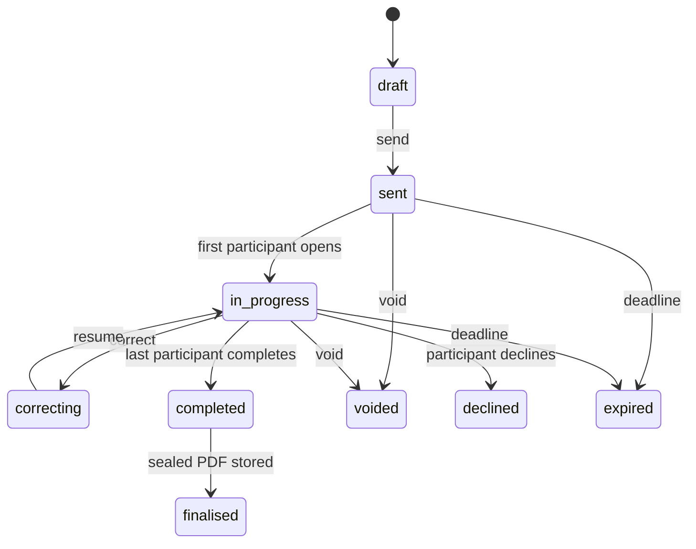

# 12 Fields, rules and workflow

**Status:** draft 0.1, 2026-09-18. Normative for sections 3 to 6 and 10. Added after the first review, in response to the product expectation that documents can be filled and signed by assigned people under customizable rules, in the manner of e-signature products.

## 1. Purpose

Regions (07) control who may edit blocks of free text. This document adds the second half of the product: typed blanks inside a document that named roles fill in, rules about what must be filled and when, a workflow that sends a document round its participants, and a sealed final PDF with evidence of who did what.

It reuses what the rest of the spec already provides. A filled value is an ordinary commit, so it is ordered, permission-checked, attributed and hash-chained like any other change. The final PDF comes from the LaTeX pipeline of 09. Decisions are recorded in ADRs [0011](../adr/0011-fields-in-tree-and-fill-capability.md), [0012](../adr/0012-typed-json-rules.md) and [0013](../adr/0013-signing-stance.md).

### 1.1 What is native and what is integrated

| Native | Integrated or left to the host |
|---|---|
| Fields, roles, rules, fill permission, workflow state, signing ceremony, evidence record, sealed PDF with a time-stamp and a certificate of completion | Sending e-mail and text messages, one-time passcodes, identity verification, advanced and qualified electronic signatures (through a signature provider adapter), payments, notarisation |

## 2. Concepts

| Term | Meaning |
|---|---|
| Field | A typed blank in the document with a stable identifier, a data key and a value |
| Role placeholder | A named role such as "Tenant" defined in the document. Fields and regions are assigned to roles, never to people |
| Participant | A person bound to one or more roles for one workflow |
| Rule | A declarative statement that shows, hides, requires, enables, validates or sets fields depending on values |
| Workflow | The resource that freezes the document body, binds people to roles, orders them, and tracks completion |
| Fill | Setting the value of a field assigned to one's role |
| Sign | Completing a signature or initials field through the signing ceremony |
| Finalise | Producing the final PDF at the completion sequence number |
| Seal | Applying a digital signature and time-stamp to the final PDF so that any later change is detectable |
| Evidence | The record of what each participant saw, consented to and did, and how they were authenticated |

## 3. Document model additions

These nodes are part of CDM version 1 so that adding them later does not need a new major version.

### 3.1 `role_def`

A definition node in `defs` with `id`, `name` and `color`. It never names a person.

### 3.2 `form_field`

An inline atom. It may appear wherever inline content is allowed in the body, including table cells. It is not allowed in headers, footers or footnotes in version 1.

| Attribute | Meaning |
|---|---|
| `id` | Node identifier (invariant I2) |
| `key` | Data label, unique in the document, for example `tenant.income`. Used by rules, prefill and extraction |
| `kind` | `text`, `number`, `date`, `checkbox`, `choice`, `signature`, `initials`, `dateSigned`, `formula`. `attachment` is reserved |
| `label` | Accessible name and summary text |
| `assignee` | A `role_def` identifier, or null for a field only authors set |
| `required`, `readOnly` | Static flags. Rules can also require or disable a field |
| `value` | The current value, typed by kind (3.3) |
| `default`, `placeholder` | |
| `options` | For `choice`: a list of `{ id, label }` |
| `format` | Display format: decimals, prefix, suffix, date pattern |
| `validation` | `min`, `max`, `minLength`, `maxLength`, `pattern` (a restricted regular expression; section 5.2), `message` (optional: what the author tells a person whose entry does not match `pattern`; owner decision 187 of 2026-11-15), `preset` (`email`, `phone`, `postcode`) |
| `width` | Fixed width in the document's length unit. Fields have a fixed width by default so that filling them does not move line and page breaks. A field with no `width` takes the default width of its kind (`FIELD_DEFAULT_WIDTH`; proposed in ADR 0380, not chosen by the owner). A value never changes the width, and a value wider than the box does not grow it |
| `sensitive` | When true, the value is readable only by its readers: participants who hold the field's assignee role, users with `manage`, and principals with a grant on the region that holds the field (ADR 0019; owner decisions 156 and 158 of 2026-11-15). Every other reader gets a redaction marker in place of `value` and `default`. How a participant is found to hold the role is proposed in ADR 0422 |

```json
{ "type": "form_field", "attrs": {
    "id": "fQ2x8Lm0aZx1VbN7", "key": "tenant.income", "kind": "number",
    "label": "Monthly income", "assignee": "role_tenant", "required": true,
    "value": null, "placeholder": "0.00",
    "format": { "decimals": 2, "prefix": "€" },
    "validation": { "min": "0", "max": "1000000" }, "width": 1920 } }
```

### 3.3 Values

| Kind | Value |
|---|---|
| `text` | String, at most 4 KiB |
| `number` | Decimal string, never a binary float |
| `date` | ISO 8601 calendar date |
| `checkbox` | Boolean |
| `choice` | An option `id` |
| `signature`, `initials` | `{ asset, mode }` where `mode` is `typed`, `drawn` or `uploaded`. Set only by the server (rule P8) |
| `dateSigned` | ISO 8601 date in the workflow's time zone. Set only by the server |
| `formula` | Decimal string or string. Set only by the server from its rule |

Values live in the document tree, as the `value` attribute. They therefore get the same ordering, attribution, hash chain, comparison, time travel and export as all other content, and there is no second source of truth. The consequences are accepted: a whole-document restore reverts values (and is refused while a workflow is active), every participant can read every value that is not marked `sensitive` (3.2; ADR 0019), and a bulk send is one fork per recipient.

### 3.4 Mirrors and long answers

- The existing `field` node gains the kind `formValue` with `target` set to a field key. It displays that field's value elsewhere in the document.
- A long, formatted answer is a region granted to a role (section 4.3), not a field.

### 3.5 `rule_def`

A definition node in `defs` with `id`, `when`, `then` and `else` (section 5).

### 3.6 Invariants

| ID | Invariant |
|---|---|
| I13 | Field keys are unique; every `assignee` resolves to a `role_def`; a `role_def` still referenced cannot be deleted |
| I14 | Every field key referenced by a rule or a `formValue` field exists; the graph of `set` effects and formulas has no cycle |
| I15 | At most 2,000 fields and 500 rules; a value is at most 4 KiB; `value` matches the type of its kind |

## 4. Permission to fill

### 4.1 Capability, role and scope

- New capability `fill`. New document-level role `filler` with `view` and `fill`.
- New scope identifier `field:<id>`. It appears in rejections and in the scopes recorded with each commit, so "who filled this field, and when" is a history query.
- `access` (05, section 5.5) gains `fill: { participant, roles, active }`. It does not list fields; the client derives fillable fields from `assignee` and the rules.

### 4.2 Rules

These extend 07, section 5. They are checked on the outcome of a commit, as all permission rules are.

| ID | Rule |
|---|---|
| P7 | Where a user has `fill` but not `edit`, the only difference a commit may make is to the `value` attribute of `form_field` nodes for which all of these hold: the field's `assignee` is one of the participant's roles; the participant is active (in a workflow, or, without one, while the document is not locked: section 13); the field's kind is not `signature`, `initials`, `dateSigned` or `formula`; the field is visible and enabled under the rules; the new value has the right type for its kind. A wrongly typed value is rejected with `field_invalid`; anything else with `permission_denied` |
| P8 | Values of `signature`, `initials`, `dateSigned` and `formula` fields change only through server-authored commits (origins `sign` and `rules`) |
| P9 | A fill commit is exclusive per field. If any commit accepted after the commit's `base` changed the same field, the commit is rejected with `conflict` and the client shows the other value. Values are not merged |

An `attr` step has no position map, so rebasing a fill commit is trivial, and the check is a lookup in the room's field index plus the rules that depend on the field.

### 4.3 Interaction with other permissions

- A user with `edit` may change any attribute of a field while the document is a draft. An active workflow removes that right (section 6).
- A `suggester` cannot set values: a value change alters the baseline of rule P4.
- A region's `approved` state and leases do not block `fill` in fields inside it.
- Region grants may name a role placeholder: the principal `role:<id>` resolves to the participants bound to that role in the active workflow.

## 5. Rules

### 5.1 Model

A rule has a condition and effects:

```json
{ "type": "rule_def", "attrs": { "id": "r_spouse",
  "when": { "==": [ { "field": "tenant.maritalStatus" }, "married" ] },
  "then": [ { "show": ["tenant.spouseName"] }, { "require": ["tenant.spouseName"] } ],
  "else": [ { "hide": ["tenant.spouseName"] } ] } }
```

| Part | Allowed |
|---|---|
| Operands | `{ "field": key }`, literals, `{ "role": ... }` for the evaluating participant's roles, `{ "now": "date" }` in the workflow's time zone |
| Operators | `==`, `!=`, `<`, `<=`, `>`, `>=`, `and`, `or`, `not`, `in`, `empty`, `matches`, and for formulas `+`, `-`, `*`, `/`, `round`, `sum`, `min`, `max`, `concat`, `if` |
| Field effects | `show`, `hide`, `require`, `enable`, `disable`, `validate` (with a message), `set` (formula) |
| Routing effects (workflow resource only) | `addParticipant`, `skipParticipant` |

### 5.2 Semantics

- The language is a closed, typed set of operators in a JSON tree. There are no loops, no user functions and no access to anything but field values, the participant's roles and the current date.
- Comparison is strict and typed. Null handling is defined per operator. Arithmetic is on decimal strings with a fixed precision. Patterns use a restricted regular-expression subset that guarantees linear-time matching.
- One implementation, `packages/rules`, runs in the editor, in the authority and in the authority service. Its behaviour is pinned by fixtures in the conformance kit, in the same way as step semantics. A backend in another language either uses the authority service or passes the fixtures.
- Evaluation is one pass in dependency order (invariant I14 guarantees an order exists) inside the commit's time budget.

### 5.3 Where rules are enforced

- The editor evaluates rules for the user: hiding, requiring, validating as they type.
- The authority enforces them at two points. On every fill commit it checks that the target field is visible and enabled. When a participant completes, it checks required fields and validations, and then, in one server-authored commit with origin `rules`, writes formula results and clears the values of hidden fields.
- The authority's verdict wins. The rejection names the rule, so the editor can explain it.

### 5.4 Where rules live

Field rules and role placeholders live in `defs`. Changing them needs `structure`, and they are frozen and hash-chained with the document when a workflow starts. Routing rules, participants and deadlines live in the workflow resource, because they involve people.

## 6. Workflow

### 6.1 Resource

One workflow per document in version 1.

```json
{
  "id": "0192f3a1-…", "doc": "0192f0…", "state": "in_progress", "rev": 5,
  "sentSeq": 640, "sentHash": "sha256:9c1f…", "timeZone": "Europe/Berlin",
  "participants": [
    { "id": "p1", "roles": ["role_tenant"], "kind": "signer", "order": 1,
      "sub": "ext:7f3a", "name": "Jane Doe",
      "auth": { "require": ["access_code"] }, "state": "completed", "completedSeq": 655 },
    { "id": "p2", "roles": ["role_landlord"], "kind": "signer", "order": 2,
      "sub": "u_481", "state": "active" } ],
  "routing": [ { "when": { ">": [ { "field": "lease.total" }, "50000" ] },
                 "then": [ { "addParticipant": { "role": "role_approver", "order": 2 } } ] } ],
  "deadline": "2026-10-18T00:00:00Z",
  "reminders": { "firstAfterDays": 3, "everyDays": 2 },
  "consent": { "textId": "esign-consent", "version": 3 },
  "finalisation": { "seal": "pades-b-lta", "certificate": true }
}
```

Participant kinds: `filler`, `signer`, `approver` (approves or declines without fields), `cc` (receives the result). Equal `order` means parallel; ascending order means sequential.

### 6.2 States



| Transition | Rules |
|---|---|
| `send` | Needs `manage`. Runs a checklist (every required field has an assignee; every role has a participant; rules validate; no unresolved suggestions). Records `sentSeq` and the chain hash. Sets the document state to `locked`. Activates the participants with the lowest `order` |
| While `sent` or `in_progress` | The authority accepts only commits allowed by P7 and P8, and edits inside a region granted to a role whose participant is active (07, section 4, limit 1). Comments stay available, because a comment never changes the document (07, section 6) |
| `correct` and `resume` | Need `manage`. Participants are paused; their commits get `read_only` and unsent values go to recovered edits. On `resume` the service compares the document with `sentSeq`, leaving out the content of regions granted to roles (their participants may edit them while the workflow runs). If the body changed, or fields of a completed participant changed, those participants are reset and must complete again. The body is never changed silently under a signature |
| `decline`, `void` | Need a reason. Terminal states keep the lock. A document is reused by forking it |
| `deadline`, `reminders`, `remind` | When the `deadline` passes (an instant, read as UTC, against the server clock), a `sent` or `in_progress` workflow becomes `expired`, keeps the lock and is recorded as a control commit; nobody fills it any more. `reminders` raise `reminder_due` for each active participant who has not completed: the first `firstAfterDays` days after the participant became active, then every `everyDays` days. The action `remind` (needs `manage`) raises it at once for the same participants and does not change the schedule. No reminder is raised for a participant who has completed or once the workflow has ended |
| `completed` | Triggers finalisation (section 8) |

Every transition is recorded in the commit log as a control commit (08, section 2), so the order of fills, signatures, corrections and completion is part of the hash chain.

### 6.3 Who sends messages

The document service sends no e-mail and no text messages. It raises webhooks (`participant_activated`, `reminder_due` and so on) and the host sends invitations and reminders in its own voice. This keeps contact details out of the document service.

## 7. Participants, authentication and evidence

- Participants are often outside the host's user base. The host backend mints their tokens, as for everyone else: document role `filler`, an opaque `sub`, the claim `wfp` with the participant identifier, and optionally `amr` and `auth_time` describing how the host authenticated them. The document service records those claims as given. It does not vouch for identity. A connection fills as the participant its token binds to, and only then: `wfp` must name a participant of this document's workflow and `sub` must be the `sub` recorded for that participant. `access.fill` then names the participant and carries the roles that participant holds in the workflow, not roles the token claims. A token that binds to no one, or a participant of a declined, voided or expired workflow, has no fill capability while the token is valid. A refreshed token whose `wfp` differs changes access and sends `perm.changed`.
- An optional access code is verified by the document service and stored only as a hash. One-time passcodes and identity verification stay with the host. The host registers the code for a participant whose `auth.require` lists `access_code` (the only method), and sends it to the person. Until the participant submits it to `verify`, their fields stay read-only. A wrong code raises `auth_failed` and is recorded in the evidence; repeated wrong codes are `rate_limited` with `retryAfterMs`.
- Evidence recorded per participant: session, IP address, user agent, `amr`, the consent text identifier, version, hash and time, the times the document was first viewed, signed and completed, the `seq` and chain hash at signing, and how the signature was adopted with the hash of its image. The service takes each item from the connection and its own clock: the session and the socket's address and `User-Agent` when the channel opens, the server time, hashes computed from stored data. No message of the client carries an address, an agent, a time or a hash. Only the items that apply to the participant's kind are recorded. The first view is recorded when the participant's channel first opens. A decline records the time and the reason as evidence of the participant who declined (proposed, ADR 0415); the control commit that follows the decline carries the salted hash of that evidence, not the reason.
- Evidence is personal data. It is kept in workflow tables, outside the commit log; only salted hashes of it enter the chain. The default retention is the life of the signed document: the evidence is kept as long as the document exists and is deleted with it (owner decision 31, 2026-11-17). It has no period and no clock, so a declined, voided or expired workflow keeps its evidence as long as its document does. A legal hold keeps it until the hold is released (08, section 11). A tenant does not choose a period in version 1 (ADR 0394 item 5, accepted with the proposed defaults, decisions 196 to 220); a tenant that needs evidence gone earlier erases one person (FRW-043) or deletes the document. This is a deliberate exception to the data-minimisation rule of 08, section 2. Tenants can switch off IP address and user agent capture.

## 8. Signing, finalisation and sealing

### 8.1 Ceremony

1. The participant reads the consent text and accepts it. The acceptance is recorded.
2. They adopt a signature: typed (the accessible default), drawn, or uploaded. The image goes through the asset worker like any other upload.
3. For each signature or initials field, the component calls `POST /documents/{id}/fields/{fid}/sign`. The service checks rule P7's conditions for that field and writes the value in a server-authored commit with origin `sign`. `dateSigned` fields assigned to the same role are set in the same commit.
4. `complete` checks required fields and validations and marks the participant completed.

### 8.2 Final PDF

1. Reaching `completed` creates an export at `completedSeq` with field values flattened into the text and with certificate pages appended. The certificate is generated LaTeX built from the evidence through the typed emitters of 09: identifiers, `sentSeq`, `completedSeq`, the chain-head hash, and each participant's events.
2. Before sealing, the bundle is compiled on two independent workers and the results are compared, which the reproducibility rules of 09 make possible.
3. A separate signing service applies a PAdES seal (baseline B-LT or B-LTA) and an RFC 3161 time-stamp. Its keys are in a hardware security module or a cloud key service. LaTeX workers never hold keys.
4. The sealed bytes are stored immutably. The chain head is written to write-once storage. An evidence bundle (log segment, control commits, evidence record, verification instructions) can be exported for third-party verification.
5. The sealed PDF is never rewritten. Long-term validation data is added only as incremental updates, and a scheduled job renews time-stamps before they expire.
6. When values or regions are hidden from some participants (ADR 0019), the owner and anyone with `manage` receive the sealed PDF of the full document, and each participant receives a sealed PDF made from their own projection, sealed separately, so that nobody holds a file with what they could not read. The evidence record states which of the two each participant received and the hashes of the full document and of each view, and holds no hidden value. Decided on 2026-11-15 (owner decision 133; ADR 0403, section 3).

### 8.3 Legal stance

- What the platform provides natively is a simple electronic signature with an audit trail and a tamper-evident seal applied by the operator (or by the tenant's own key). This matches how Microsoft and others describe comparable features.
- Advanced and qualified electronic signatures under eIDAS need per-signer certificates, sole control and, for qualified signatures, a qualified device and trust service provider. They are reached through a `SignatureProvider` adapter that signs document hashes remotely (the Cloud Signature Consortium API is the target).
- Product language must never say "qualified", "legally binding everywhere" or similar. Intent, consent and retention requirements of ESIGN and UETA are addressed by the ceremony and the evidence record; whether a given use is valid in a given jurisdiction is a legal question for the operator and its customers.

## 9. Templates, prefill and bulk send

- A template is a document with role placeholders, fields and rules, and no participants. Instantiating it forks the document at a pinned `seq`, binds participants and optionally prefills values.
- Prefill is `PATCH /documents/{id}/field-values` by key. It produces a server-authored commit with origin `prefill`. Signature, initials, date-signed and formula fields cannot be prefilled. Values are typed data and go through the same emitters as any text; exported spreadsheets neutralise leading `=`, `+`, `-` and `@`. The spreadsheet output of field values is CSV (owner decision 44): `GET /documents/{id}/field-values?format=csv`, one row of key and value for each field, a cell that starts with one of those four characters written with an apostrophe in front, and the JSON of the same route unchanged (ADR 0410, proposed).
- Bulk send is a job that creates one fork per recipient row.

## 10. Protocol additions

| Area | Addition |
|---|---|
| Features | `fields`, `rules`, `workflow`, `sign`, `seal` |
| Real-time plane | Fills are ordinary `sync.submit` messages with origin `fill`. New reject codes `field_invalid` and `conflict`. `wf.changed` (S to C) carries the workflow state and the participant's status, and is sent like `perm.changed` |
| Control plane | `/documents/{id}/fields` (GET); `/documents/{id}/field-values` (GET with `?seq`, PATCH for prefill); `/documents/{id}/workflow` (GET, PUT while draft) with actions `/workflow/send`, `/workflow/correct`, `/workflow/resume`, `/workflow/remind` and `/workflow/void` (each a `POST`; the method and path are assumed, G95); `/workflow/participants/{pid}/consent`, `/verify`, `/access-code` (the host registers a code; a `POST`, assumed, G95), `/complete`, `/decline`; `/documents/{id}/fields/{fid}/sign`; `/documents/{id}/workflow/evidence`; `/documents/{id}/workflow/final`; `/templates` (GET, POST); `/templates/{tid}` (GET); `/bulk-sends` (POST); `/bulk-sends/{bid}` (GET); `/workflow/capture-settings` (GET, PUT; the tenant setting for IP address and user agent capture in evidence, service credential only, `If-Match` on PUT; assumed, G95). New problem code `workflow_active` |
| Webhooks | `dep.workflow.sent`, `participant_activated`, `participant_viewed`, `field_completed`, `participant_completed`, `participant_declined`, `auth_failed`, `reminder_due`, `corrected`, `voided`, `expired`, `completed`, `finalised` |
| Embedding API | Attribute `mode="fill"`. Methods `nextField()`, `focusField(key)`, `getFieldValues()`, `setFieldValue(key, value)`, `validateFields()`, `completeFilling()`, `decline(reason)`. Events `de-field-change` with `{ fieldId, key, valid, empty }` and no value, `de-fill-progress`, `de-sign-request`, `de-workflow-complete` |
| Conformance | Profiles `fields`, `perm-fill`, `rules`, `workflow`, `sign`, `seal`. `perm-fill` is a property test: a fill-only participant changes nothing but the values of fields assigned to their roles |

## 11. Frontend

- **Authors** get a field palette, a properties panel, a roles manager (colour plus an icon, never colour alone), a rule builder that reads as a sentence, "preview as role", and the pre-send checklist.
- **Participants** see a read-only body and a guided bar: next required field, "n of m", finish. Fields of other roles are labelled with the role name. A summary lists required and invalid fields with links.
- Accessibility: every field is a labelled control in the same shadow root, with `aria-required` and `aria-invalid`. The typed signature is the default so that signing never requires drawing. One-time passcode inputs allow paste.
- In the web view, fields are node views that contain native controls. In the page view they are painted widgets on the painter's interactive overlay layer (02, section 9.5), and how assistive technology reaches them is part of spike S9.

## 12. Export

- **PDF:** values are flattened into the text and tagged with their labels. `layout.json` reports the rectangle of every field so that the signing service can place visible signature appearances. Live PDF form fields are not produced in version 1: LaTeX's form support is limited and is being reworked upstream.
- **DOCX:** each field becomes an inline content control with the key as tag, the label as alias, a lock, and data binding to a custom XML part. Assignees and rules are stored in a second custom part. Word's "filling in forms" protection is set and, as always, is advisory only.

## 13. Phasing

| Phase | Scope |
|---|---|
| 0 | Extend spike S3 with P7 and P9. New spike S8: seal a tagged LuaLaTeX PDF with a key held in a key service and validate it in Acrobat |
| 1b | "Form mode" without a workflow: `role_def`, `form_field` with `text`, `number`, `date`, `checkbox` and `choice`; `fill` with roles taken from a token claim; `required` and type checks; `mode="fill"`; prefill; flattened PDF; profiles `fields` and `perm-fill` |
| 2 | Rules engine; workflow; signing ceremony; evidence; certificate of completion; webhooks; seal with a time-stamp; DOCX round trip of fields, with the DOCX writer (11, section 5) |
| 3 | Fields in the page view; field rectangles in `layout.json` used for visible signature appearances |
| 4 | Long-term validation and re-time-stamping; templates and bulk send; routing rules; signature provider adapter |

### Form mode without a workflow (phase 1b)

Decided by the owner on 2026-11-15 (`docs/owner-decisions-2026-11-15.md`, decision 5): form mode without a workflow is the first slice and stays in phase 1b. The stories FRW-001 to FRW-011, FRW-060, FRW-061, FRW-065 to FRW-067, FRW-069, FRW-070, FRW-072 to FRW-074, FRW-076 to FRW-080 and EXP-033 stay in 1b. In that mode:

- **Fill roles** come from a token claim that lists role placeholders. Its name is configurable per tenant; `wfr` is the default (05, section 3.1).
- **"Active"**: `access.fill.active` is true and a participant is active while the document is not locked. On a locked document the limit of 07, section 4 applies.
- **Finish and `completeFilling()`** are configurable per document, with a tenant default. The default validates the fields and raises events only. The other setting also makes that person's fields read-only. The names of the document setting and of the tenant default are fixed when FRW builds them.
- **Authoring**: fields are authored in 1b through the editor (the palette and the properties panel, FRW-072 to FRW-074), not through the API alone.

Out of scope: native advanced or qualified signatures, identity verification, notary and witness roles, payments, sending e-mail or text messages, packets of several documents, repeating sections, signing uploaded PDFs. Read restrictions per field are in scope since 2026-11-06 (ADR 0019).

## 14. Pitfalls this design is built around

| Pitfall | Response |
|---|---|
| Marketing language that over-claims | Section 8.3 |
| Signer identity is only as strong as the host's authentication | Record the host's assertion; never vouch for it |
| Evidence retention against erasure rights | Personal data outside the chain, commitments inside it; legal hold already exists (08) |
| Time | Server clock plus RFC 3161 tokens; `dateSigned` follows the workflow's time zone |
| PDF signature validity after later changes | Never rewrite; incremental updates only; test certification levels in Acrobat |
| Long-term validation | Scheduled re-time-stamping |
| Signing that excludes people | Typed signature default; keyboard-only ceremony; no reliance on colour |
| An author correcting while someone fills | Pause, compare, reset affected participants |
| Filling moves page breaks | Fixed-width fields and `maxLength` |
| Template changes after sending | Packets are forks pinned to a template `seq` |
| Prefill as an injection path | Typed values, one escaping layer, no prefill of server-set kinds |
| Client and server disagree about a rule | One package, shared fixtures, the server wins and explains |
| Rule loops | Invariant I14; one pass in dependency order |

## 15. Open questions for the project owner

1. Does the host alone deliver invitations and authenticate participants, or must the hosted service also send messages and host a signing page? Decided on 2026-11-06: the host alone (SPK-010).
2. Which jurisdictions come first, and is a simple signature with a seal enough at launch? Who is the sealing party: the operator or each tenant? Decided on 2026-11-15 (SPK-011): the European Union and the United States from the start; the operator seals by default, and a tenant's own key and certificate are used where the tenant supplies them. The launch level stays a simple signature with a seal.
3. Is form mode without a workflow acceptable as the first slice? Decided yes on 2026-11-15 (FRW-083); see section 13.
4. Must some values be hidden from other participants? Decided yes on 2026-11-06 (SPK-005); ADR 0019 proposes the design.
5. Are repeating line items with totals needed early?
6. Are packets of several documents needed?
7. What is the default evidence retention period? Decided on 2026-11-17: as long as the signed document exists, deleted with it (FRW-084; owner decision 31). A tenant does not choose a shorter period in version 1 (ADR 0394 item 5, accepted with the proposed defaults, decisions 196 to 220).
8. Should fields have a fixed width, or may the document reflow while it is filled? Decided on 2026-11-06: fixed width (SPK-012).
9. Should comments be switched off while a workflow is active? They are technically harmless, because they do not change the document, but some signing processes want a quiet document. Decided on 2026-11-15: no, comments are always on (FRW-085; owner decision 131; ADR 0404). There is no setting to switch them off.
